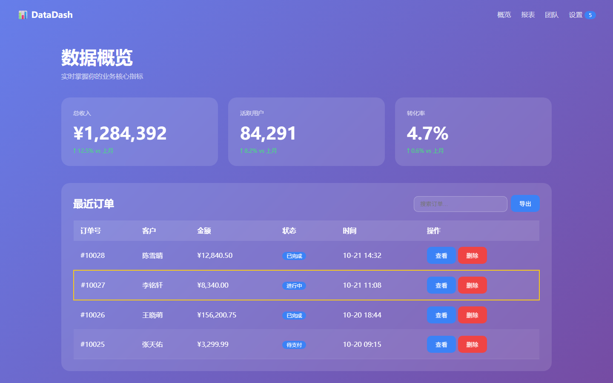
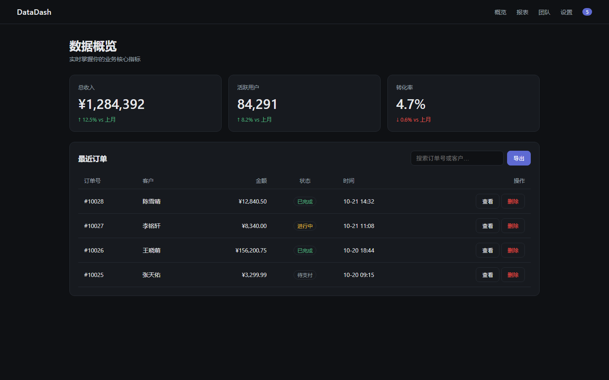
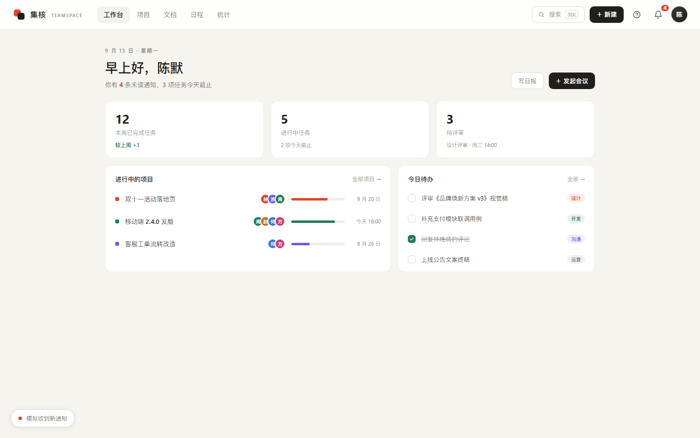
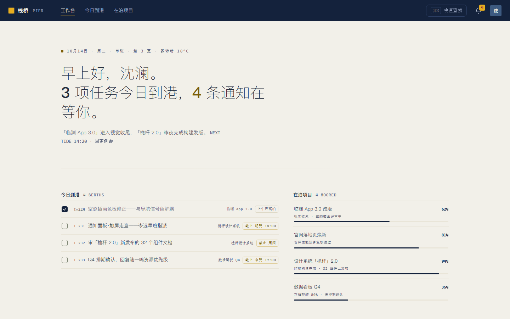

<div align="center">

# ZY's Anti-Slop Frontend Design

### ZY 的反同质化 AI 前端设计知识库

An AI frontend design knowledge base for Chinese and English creative workflows.<br>
一个面向中英文创作的 AI 前端设计知识库。

[简体中文](README.md) · [English](README.en.md)

[](LICENSE)

<sub>Maintained by ZY（智宇）</sub>

</div>

---

| Left: AI default output (purple gradient + glass cards) | Right: same page after this library's audit + decision objects |
|---|---|
|  |  |

<sub>Same interface, same data — the only difference is whether every detail had someone make a decision about it. Full comparison in [cases/](cases/README.md)</sub>

## Why this exists

The central problem with AI-generated frontends is rarely the ability to write code. It is the tendency to regress to statistical averages: Inter, a purple-blue gradient, three rounded cards, and uniform medium density everywhere. This library turns 210+ research-informed design documents into four practical capabilities:

1. **Taste & inspiration** — style vocabularies, visual descriptors, and paste-ready prompts that make “looks good” actionable.
2. **Decision objects** — the K board (K0–K18, 92 entries): interaction and visual concepts decomposed into “symptoms → decision points → implementation → acceptance” entries.
3. **Differentiation** — anti-slop checks and reference-to-originality methods that move a design beyond common defaults.
4. **Validation** — an audit loop plus evidence cases that make quality reviewable and provable.

## Measured evidence

Two agents received the same brief: one ran bare, the other ran this library's pipeline (AGENTS.md → retrieval → term decisions → audit). A third agent scored both blind across nine dimensions:

| | Bare run (no library) | Armed run (library pipeline) |
|---|---|---|
|  |  |
| Blind score 65.5/90 | **79.5/90 (+14, won all nine dimensions)** |
| Density rhythm 5.5 | 9.0 |
| Behavioral detail 6.5 | 9.5 |

Honest caveat: one task, same-family judge — indicative evidence, not a statistical claim. Full process and reports: [cases/04-生成AB对照](cases/04-生成AB对照/record.md).

## Three ways to use it

- **Find inspiration** — browse the style vocabularies (B16, B86, B87) and the paste-ready visual prompt library (R0–R18).
- **Feed your AI as context** — drop `AGENTS.md` plus 5–12 relevant docs into your project; the model then considers nine dimensions (visual, information, spatial, interaction, motion, behavior, engineering, performance, acceptance) before writing code.
- **Upgrade an existing page** — run the K10 nine-dimension audit prompt, hit K-term decision points, verify against acceptance criteria.

## A note from ZY

> Generating an interface with AI is easy. Generating one with judgment, character, and a credible path to implementation is the real goal of this library.

This is a reference collection distilled from the prompts, visual decisions, and review checks I repeatedly use in real AI-assisted frontend work. It does not design a product for you; it helps turn a vague request to “make it look good” into decisions that can be chosen, combined, implemented, and checked.

Different models, contexts, stacks, and implementation skills produce different results. The library does not guarantee a strong outcome from every model. Use it with your product context, then validate and iterate.

The document set is currently Chinese-led. English documentation will grow over time; the language switch is here so both communities have a clear entry point from the start.

This library is free to access under [CC BY 4.0](LICENSE): copying, sharing, adaptation, and commercial use are allowed with attribution, a link to the license, and an indication of changes.

## Quick start

1. Add `00-总索引.md` and `AGENTS.md` to your project context.
2. Define the product context, then use [Z2](docs/Z2-Prompt检索与组合编排.md) to select 5–12 relevant documents before generating with [M1](docs/M1-AI生成顶级前端方法论.md).
3. Run the [Z3](docs/Z3-前端质量审计与迭代闭环.md) five-round audit and fix P0/P1 findings in the result.

## Library map

| Area | Focus |
|---|---|
| `00-*` | Index and planning |
| `A`–`B` | Visual fundamentals and deep visual craft |
| `C`–`D` | UX/content patterns and design systems |
| `E`–`H` | Trends, engineering resources, product contexts, behavior and conversion |
| `K` | Term-level decision objects: symptoms → decision points → acceptance (K0 index, K10 nine-dimension audit) |
| `M` / `P` | Methods, governance, typography, and layout |
| `R` | Directly usable visual-prompt vocabulary, composition rules, and technical constraints |
| `S` / `T` / `V` / `Z` | Desktop design, measurement, visual effects, and prompt control |

The full navigable index is [00-总索引.md](00-总索引.md).

## Workflow

```text
Product need
  → M2: understand and maintain the knowledge base
  → Z2: retrieve only the most relevant knowledge
  → M1 / Z1: plan and generate
  → Z3: audit and repair the result
  → record failure modes and improve the library
```

## For AI coding tools

Place `AGENTS.md` in a project root so tools such as Codex, Claude Code, Cursor, and Copilot can retrieve the library by area, generate against an explicit method, and run the audit checklist afterward.

## Contributing

Contributions are welcome: new visual dimensions, verifiable engineering rules, corrections, and especially failure modes learned from real projects. Please read [CONTRIBUTING.md](CONTRIBUTING.md) before opening a pull request.
