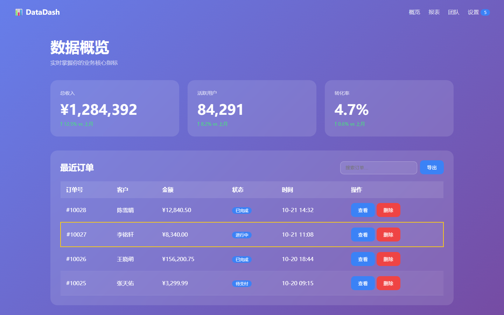
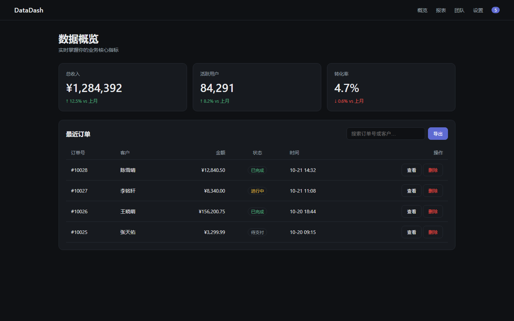
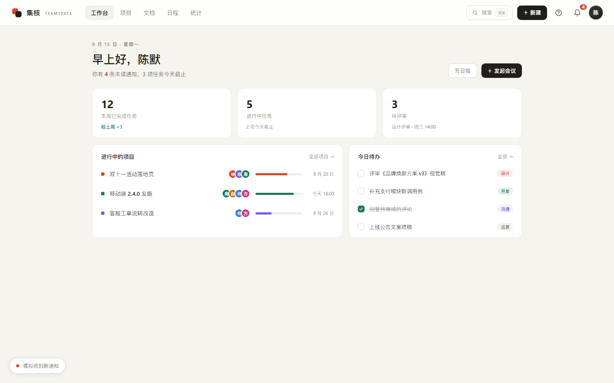
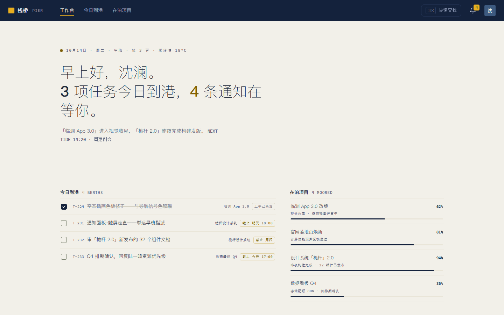

<div align="center">

# ZY 的反同质化 AI 前端设计知识库

### ZY's Anti-Slop Frontend Design

一个面向中英文创作的 AI 前端设计知识库。<br>
An AI frontend design knowledge base for Chinese and English creative workflows.

[简体中文](README.md) · [English](README.en.md)

[](LICENSE)

<sub>Maintained by ZY（智宇）</sub>

</div>

---

| 左：AI 默认产出（紫蓝渐变 + 玻璃卡片 + 无效动效） | 右：用本库 K10 九维审计 + 词条决策点修复后 |
|---|---|
|  |  |

<sub>同一界面、同一份数据——差别只在"有没有人替每个细节做过决定"。完整对照见 [cases/](cases/README.md)</sub>

## 为什么有它

AI 生成前端最大的问题不是"不会写代码"，而是**默认回到统计平均值**：Inter 字体、紫色渐变、三张圆角卡片、均匀中密铺满全页。这个库用 210+ 篇可检索、可组合、可验证的设计文档，解决四个问题：

1. **品味与灵感**：B/R 板块——风格词库、视觉描述词、可粘贴提示词，把"好看"拆成可执行的原理与公式
2. **决策维度**：K 板块（K0–K18，92 个词条）——把交互/视觉概念拆成"症状→决策点→实现→验收"的决策对象，告诉你哪些点必须给答案
3. **差异化**：B82（反 AI 味）、B85（从参考到原创的演化法）——主动偏离 AI 共同分母
4. **验证闭环**：Z3（审计闭环）、cases/（实证案例）——让质量可打分、可迭代、可证明

## 实测证据

同一任务书喂给两个 agent，一个裸跑、一个按本库管线（AGENTS.md→检索→词条决策→审计）执行，第三方按九维框架**盲审**（不知道哪份是哪组）：

| | 裸跑（无库） | 武装（本库管线） |
|---|---|---|
|  |  |
| 盲审得分 65.5/90 | **79.5/90（+14，九维全胜）** |
| 密度节奏 5.5（均匀中密，无峰谷） | 9.0（呼吸峰真实落地） |
| 行为细节 6.5 | 9.5 |

裁判原话："右边更像真实产品，左边更像高质量作业/精修模板。" 诚实标注：单任务、同族模型裁判，是指示性证据而非统计结论——完整过程与原始报告在 [cases/04-生成AB对照](cases/04-生成AB对照/record.md)。

## 三种用法（30 秒判断它对你有没有用）

- **手写 prompt / 一页看全库**：[Z4 提示词配方公式](docs/Z4-提示词配方公式与速查.md)——骨+皮+量+禁四槽公式，全词速查+三个实证配方，填槽即成 prompt
- **找灵感**：直接翻 [B16 风格词库](docs/B16-惊艳风格词库.md)、[B86 维度词库](docs/B86-界面生成维度词库.md)、[B87 结构词库](docs/B87-结构与内容展示词库.md)、[R 可粘贴提示词库](docs/R0-视觉提示词库总索引与用法.md)——大量现成的视觉描述词与组合公式
- **喂 AI 当上下文**：把 `AGENTS.md` + 相关 5-12 篇放进项目，AI 会自动按九维考虑（视觉/信息/空间/交互/动效/行为/工程/性能/验收）再动手；或直接粘 Z4 §六 的两张卡指令
- **改旧页面**：拿 [K10 九维审计](docs/K10-界面审计九维框架.md) 的诊断 prompt 扫症状 → 命中 K 词条 → 逐项答决策点 → 按验收项核对

## 写在前面

> 让 AI 写出界面不难；让它做出有判断、有气质、也能真正落地的界面，才是这套库想解决的事。

这套库来自我实际使用 AI 生成前端时反复调用、持续整理的提示词、视觉判断与检查项；是基于个人前端 AI 实践沉淀下来的参考集合。它不替你做设计，而是把模糊的“做得好看”拆成能够选择、组合、实现和验证的具体决定。

不同模型、上下文、技术栈和实现能力会带来不同结果，因此它不保证每个模型都能生成理想效果。请结合自己的项目进行取舍、验证和迭代。

不必照抄全库。请从你的产品、内容、技术栈和约束出发，取用真正有帮助的部分，形成自己的取舍与表达。

也欢迎你继续补充、修正和深化它：新的视觉维度、可验证的工程规则，或真实项目中踩过的坑，都能让这套库帮助更多人做出更好的前端。

本库免费公开，采用 [CC BY 4.0](LICENSE) 许可：允许复制、分享、改编及商业使用，但需署名、附上许可链接并说明修改。

## 快速开始（3 步）

1. 克隆本仓库，把 `00-总索引.md` 与 `AGENTS.md` 加入你的项目
2. 做项目时：整理产品上下文 → 按 [Z2](docs/Z2-Prompt检索与组合编排.md) 检索 5-12 个模块 → 按 [M1](docs/M1-AI生成顶级前端方法论.md) 生成
3. 生成后：按 [Z3](docs/Z3-前端质量审计与迭代闭环.md) 五轮审计，实际修复 P0/P1 问题；升级已有界面时按 [K10](docs/K10-界面审计九维框架.md) 九维扫症状 → 命中 K 词条答决策点

## 目录结构

| 板块 | 内容 | 代表文件 |
|---|---|---|
| `00-*` | 索引与规划 | 总索引、补齐计划清单 |
| `A1-A3` | 视觉基础原理 | 格式塔、认知心理学、无障碍原则 |
| `B1-B86` | 视觉设计专题（排版/色彩/动效/布局/质感/品牌/差异化） | B82 反 AI 味、B85 参考→原创演化法 |
| `C1-C7` | 内容与交互模式 | C6 真实内容系统、C7 无障碍合规 |
| `D1-D5` | 设计与工程系统 | D3 设计令牌、D5 界面结构蓝图 |
| `E1-E4` | 视觉趋势与竞品参考 | E2 2025-2026 趋势 |
| `F1-F5` | 前端资源与工具 | F4 Tailwind/shadcn、F5 工具速查 |
| `G1-G7` | 场景与行业 | G1 落地页、G7 行业视觉速查 |
| `H2-H3` | 行为与转化 | H3 CRO 与说服工程 |
| `K0-K18` | 词条决策对象层（症状→决策点→验收） | K0 检索入口、K1 吸附、K4 拖拽、K10 九维审计、K13 表格、K15 流式 |
| `M1-M3` | 方法论与治理 | M1 AI 生成顶级前端方法论 |
| `P1-P2` | 排版与布局 | P1 排版秘籍 |
| `R0-R18` | 可粘贴视觉提示词库（实时图形/Shader/组合公式） | R0 入口与调度、R5 色彩管线、R10 排印图形化 |
| `R19-R22` | 视觉方法论与维度清单 | R20 视觉总纲（L0-L5 模型）、R19/R22 维度覆盖度检查表 |
| `S1` | 桌面软件视觉设计（WPF/WinUI/Avalonia） | S1 WPF 桌面软件视觉设计系统 |
| `T1-T2` | 度量与验收 | T2 UI/UX 质量度量体系 |
| `V1-V14` | 视觉特效 | 玻璃拟态、3D、颗粒、动态渐变 |
| `Z1-Z3` | Prompt 与控制 | Z1 终极 Prompt 生成器、Z3 审计闭环 |

## 推荐工作流

```text
用户需求
  → M2：理解全库与升级规则
  → Z2：读取上下文，检索最相关知识
  → M1/Z1：规划并生成
  → Z3：审计结果并实际修复
  → 记录失败模式，回写 M2/Z2 或对应专题文档
```

## 给 AI 用（核心亮点）

把 `AGENTS.md` 放进项目根目录，Claude Code / Cursor / Copilot 等工具即可自动消费本库：按板块检索、按方法论生成、按审计清单自检。

## 贡献

欢迎贡献新专题或深化已有文档。请先阅读 [CONTRIBUTING.md](CONTRIBUTING.md)，并遵守：
- 文件名：`板块字母-编号-标题.md`（如 `B86-xxx.md`）
- 结构：标题 → 说明 → 表格为主 → 末尾附"参考资料（第 N 轮深挖）"
- 数据优先：有数据不写形容词，附来源
